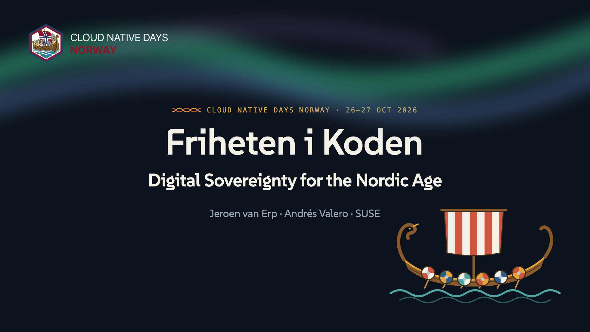
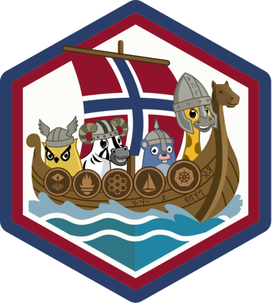

<p align="center">
  <a href="https://suse-technical-marketing.github.io/cnds-norway-2026-slides/">
    
  </a>
</p>

# Friheten i Koden: Digital Sovereignty for the Nordic Age

Slides and resources for the talk by **Jeroen van Erp** and **Andrés Valero**
(SUSE) at [Cloud Native Days Norway 2026](https://cloudnativedays.no/),
Bergen, 26–27 October 2026.

<p align="center">
  
</p>

<h3 align="center">▶ <a href="https://suse-technical-marketing.github.io/cnds-norway-2026-slides/">View the slides</a></h3>

Runs in any browser, on your phone too. Use the arrow keys or swipe to move
between slides.

## About the talk

Digital sovereignty is dominating boardroom conversations across Europe. However, it's being built, or broken, in pull requests. Every managed service you adopt, every proprietary SDK you reach for, every platform decision made for convenience over portability: these are sovereignty decisions, and they're being made by developers and platform engineers every single day.

This talk is not for your CISO. It's for you.

The Vikings didn't avoid the world, they were among its greatest traders and explorers. But they sailed their own ships, charted their own routes, and never handed control of their journey to a foreign power. Today's cloud landscape demands the same mindset. International companies cannot function without hyperscalers, and this talk won't pretend otherwise. AWS, Azure, and GCP are not the enemy. Dependency without contingency is.

In recent years, a wave of policies and compliance frameworks has reshaped the landscape, from the EU Data Act and NIS2 to the Cloud Sovereignty Framework. But cutting through that noise to find what actually matters for the people building applications and infrastructure is harder than it sounds. What does "off-ramp ready" look like in practice? We'll explore how industry standards, CNCF-aligned tooling, and open source solutions, covering everything from cluster management to open virtualization and zero-trust security, can give platform teams the portability, transparency, and control that proprietary stacks simply cannot offer. Not as a religion, but as a pragmatic engineering strategy.

But tools alone aren't enough. Sovereignty can't be bolted on at the end of a project or handed down from a compliance team. It has to live in your team's culture. You need to have a habit of naming trade-offs explicitly, building abstraction layers where lock-in risk is highest, and treating portability as a first-class architectural concern.

You'll leave with a clear mental model for thinking about sovereignty at the platform level, concrete architectural patterns for reducing lock-in without abandoning the cloud, and three actions you can take next Monday morning, no executive sign-off required.

Your longship should be yours to sail.

## Key takeaways

**Sovereignty is an engineering property.** Four timbers make the keel:

| Timber | The question to ask |
|---|---|
| Jurisdiction | Whose law can reach this workload? Follow the parent entity, not the region logo. |
| Control | Who holds the keys, the identity, the data? |
| Portability | How hard is it to leave? What's the off-ramp? |
| Transparency | Can you audit the stack? Open source, docs, SBOMs. |

**Three things you can do on Monday morning:**

1. **Build it.** Hold your own keys. Put customer-managed keys (BYOK) on your
   most sensitive store, and wrap one proprietary SDK call behind an
   interface you own. One PR, about a day.
2. **Control it.** Know what's in the hold. Generate an SBOM for every image
   (SPDX or CycloneDX), sign it with provenance (SLSA), and add a policy
   gate: unsigned or unknown doesn't ship.
3. **Make it a habit.** Run an off-ramp test every quarter, like a DR drill:
   add a second region or provider in your IaC, move a workload, and verify:
   - Can you export in open formats?
   - Do the keys follow?
   - Does it boot on Postgres and an S3-compatible API?

Find the gaps on a quiet Tuesday, not during an outage.

**Lock-in trap or seaworthy?** The six patterns from the quiz:

| Pattern | Verdict |
|---|---|
| Workloads in the EU region of a US hyperscaler, "data never leaves Europe" | Lock-in trap |
| Checkout business logic living entirely inside serverless functions | Lock-in trap |
| A proprietary SDK feature on the hot path, wrapped behind your own interface | Seaworthy |
| A database leaning on provider-managed extensions and stored procedures | Lock-in trap |
| Telemetry on OpenTelemetry, with your own DNS and identity provider | Seaworthy |
| "We'll write an exit plan if we ever need one" | Lock-in trap |

## Sources and further reading

- **Market:** Gartner,
  [Worldwide Sovereign Cloud IaaS Spending Will Total $80 Billion in 2026](https://www.gartner.com/en/newsroom/press-releases/2026-02-09-gartner-says-worldwide-sovereign-cloud-iaas-spending-will-total-us-dollars-80-billion-in-2026),
  press release, 9 Feb 2026. The slide uses the Europe figures.
- **EU Cloud Sovereignty Framework** (the eight SOV objectives and the
  SEAL 0–4 levels):
  [framework document](https://commission.europa.eu/document/download/2ad80a48-166f-4c77-a513-80c53ca2a128_en)
  and the
  [Commission's procurement announcement](https://commission.europa.eu/news-and-media/news/commission-advances-cloud-sovereignty-through-strategic-procurement-2026-04-17_en),
  17 Apr 2026.
- **EU Data Act**, Regulation (EU) 2023/2854:
  [EUR-Lex](https://eur-lex.europa.eu/eli/reg/2023/2854/oj). Article 25
  covers switching between cloud providers.
- **Cyber Resilience Act**, Regulation (EU) 2024/2847:
  [EUR-Lex](https://eur-lex.europa.eu/eli/reg/2024/2847/oj).
- **Cloud and AI Development Act (CADA)**, proposed by the Commission on
  3 June 2026 as part of the Tech Sovereignty Package:
  [summary by techUK](https://www.techuk.org/resource/europe-s-technology-sovereignty-package-what-do-the-cloud-ai-development-act-and-chips-act-ii-mean-for-uk-tech.html).
  Still a proposal.
- **"No, I cannot guarantee it."** Anton Carniaux of Microsoft France,
  testifying under oath to a French Senate inquiry, June 2025:
  [The Register](https://www.theregister.com/2025/07/25/microsoft_admits_it_cannot_guarantee/).
- **Open source building blocks named in the talk:**
  [OpenTelemetry](https://opentelemetry.io/),
  [Cluster API](https://cluster-api.sigs.k8s.io/),
  [KubeVirt](https://kubevirt.io/),
  [Open Policy Agent](https://www.openpolicyagent.org/),
  [Kyverno](https://kyverno.io/),
  [SLSA](https://slsa.dev/),
  [SPDX](https://spdx.dev/) and
  [CycloneDX](https://cyclonedx.org/).

## The speakers

- **Jeroen van Erp**, Principal Technology Advocate, SUSE ·
  [LinkedIn](https://www.linkedin.com/in/jvanerp/)
- **Andrés Valero**, Principal Technology Advocate, SUSE ·
  [LinkedIn](https://www.linkedin.com/in/avaleror/)

## Run the slides locally

The deck is built with [Slidev](https://sli.dev). You need
[Bun](https://bun.sh) (or Node.js with `npx`).

```bash
bun install
bun run dev      # live preview at http://localhost:3030
bun run build    # static site in dist/, works fully offline
bun run export   # PDF export
```

Keyboard: arrows or space to move, `f` for fullscreen, `o` for the slide
overview, `p` for presenter mode with speaker notes.

Repository layout:

- `slides/slides.md` holds the slides and the speaker notes.
- `slides/style.css` is the Viking voyage theme.
- `slides/global-top.vue` draws the voyage bar along the bottom.
- `slides/components/` holds the hand-drawn SVG illustrations.
- `slides/public/` holds images and QR codes.

Every push to `main` publishes the deck to GitHub Pages through
`.github/workflows/pages.yml`.

## License

- Slide content (text, illustrations, speaker notes) is licensed under
  [CC BY 4.0](LICENSE-CONTENT). Reuse it freely, with attribution.
- Code (Vue components, styles, build configuration) is licensed under
  [MIT](LICENSE).
- The Cloud Native Days Norway logo is used with the organisers' permission
  and is not covered by these licenses. Neither are the speaker photos.
